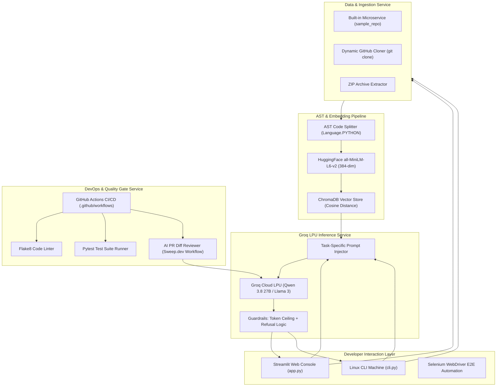
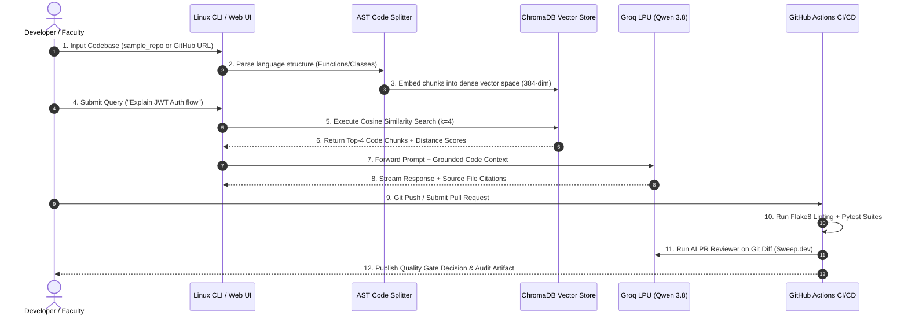

# 📊 CodeSense AI — Mid-Semester Examination Presentation Deck
**Course:** CSE 4011: Intelligent Developer Tools and AI DevOps Workflows  
**Institution:** School of Engineering and Technology, BML Munjal University  
**Team Members:** Jhalak Kapila, Khushi Hooda, Aastha Thakur  
**Project Title:** CodeSense AI: AST-Aware Semantic Code Intelligence & Automated DevOps Quality Gate  
**Evaluation:** A2 — Mid-Term Project Defense (30% Weightage)  

---

## 📑 Slide Deck Index (12-Slide Master Presentation)

* **Slide 1:** Title & Project Identity
* **Slide 2:** Problem Statement & Developer Cognitive Load
* **Slide 3:** Project Objectives & Expected Outcomes
* **Slide 4:** Tools & Technology Stack Matrix
* **Slide 5:** Comprehensive System Architecture (7-Service Topology)
* **Slide 6:** Complete End-to-End Data & Execution Workflow
* **Slide 7:** AST-Aware Semantic Ingestion & Vector Retrieval Pipeline
* **Slide 8:** AI-Driven DevOps Quality Gate (Sweep.dev & GitHub Actions)
* **Slide 9:** Automated Test Synthesis & Regression Defense (CodiumAI)
* **Slide 10:** Dual Interface Demonstration (Linux CLI Machine & Web Console)
* **Slide 11:** Progress vs. Plan & Verification Evidence (5/5 Passing Tests)
* **Slide 12:** Conclusion, Architectural Guardrails & Next Steps (Phase 3)

---

## 🖥️ Slide-by-Slide Content & Speaker Script

---

### 🟢 Slide 1: Title & Project Identity
* **Slide Title:** **CodeSense AI**
* **Subtitle:** AST-Aware Semantic Code Retrieval & AI-Driven DevOps Quality Gate
* **Course:** CSE 4011: Intelligent Developer Tools and AI DevOps Workflows
* **Team Members & Responsibilities:**
  * **Jhalak Kapila** — Core RAG Engine & DevOps Architecture
  * **Khushi Hooda** — Automated Testing & Quality Assurance
  * **Aastha Thakur** — UI/UX, Ingestion & Tool Setup
* **Academic Year:** 7th Semester | Batch 2023–27 | BML Munjal University
* **GitHub Repository:** `https://github.com/Jhalakk12/CodeSenseAI`

> **🎙️ Speaker Script (15 Seconds):**  
> *"Good morning, Sir. Today our team is presenting CodeSense AI — an intelligent developer tool and automated DevOps quality gate. Our team consists of Jhalak Kapila as the team lead and core systems architect, Khushi Hooda leading automated testing and QA, and Aastha Thakur handling the UI console and tool integration. Our project bridges the gap between semantic codebase understanding and automated CI/CD pipeline auditing by combining AST-aware code retrieval with Groq LPU acceleration and automated pull request quality gates."*

---

### 🟢 Slide 2: Problem Statement & Motivation
* **Slide Title:** **Problem Statement: Cognitive Load & Traditional CI/CD Blindspots**
* **Key Challenges in Modern Software Engineering:**
  1. **Semantic Blindness in Static Search:** Traditional tools (grep, regex, standard IDE search) rely on exact lexical matches and cannot understand architectural intent, inter-service contracts, or runtime flows.
  2. **High Developer Onboarding Friction:** Navigating distributed microservices takes weeks for new engineers due to undocumented dependencies.
  3. **Superficial CI/CD Quality Gates:** Conventional pipelines only run pre-written, static unit tests; regressions in modified pull request diffs frequently slip through unnoticed into production.
  4. **The Hallucination & Latency Bottleneck:** Generic LLM assistants hallucinate non-existent APIs and suffer from high latency (3–10s) when processing large codebases.

> **🎙️ Speaker Script (30 Seconds):**  
> *"In modern software organizations, developers spend over 60% of their time simply navigating complex codebases. Traditional grep or regex tools fail because they don't understand semantics — if a developer asks how authentication is structured, regex cannot connect route handlers to token encoders. Furthermore, traditional CI/CD pipelines only execute pre-existing tests. If a developer submits a PR with edge-case bugs, the pipeline passes green. CodeSense AI solves both: it gives developers instant semantic understanding and acts as an automated AI gatekeeper during pull requests."*

---

### 🟢 Slide 3: Project Objectives & Outcomes
* **Slide Title:** **Project Objectives & Scope (A1 / A2 / A3)**
* **Core Objectives:**
  * **O1 — Semantic Codebase Intelligence:** Parse and index polyglot repositories using language-specific Abstract Syntax Trees (AST) into 384-dimensional dense vectors.
  * **O2 — Sub-Second LPU Inference:** Deliver deterministic, ultra-low latency code Q&A (< 1s) with transparent reasoning traces and mathematical source citations.
  * **O3 — Automated CI/CD PR Reviewer (Sweep.dev Workflow):** Inspect incoming `git diff` during GitHub Actions workflows, identify security vulnerabilities, and enforce quality gates.
  * **O4 — Behavior-Driven Test Generation (CodiumAI Workflow):** Synthesize runnable, isolated `pytest` regression suites for newly written or modified functions.
  * **O5 — Headless OCI Containerization:** Package the engine into an OCI container executable on any Linux CLI machine or Docker runtime with zero Windows dependency.

> **🎙️ Speaker Script (25 Seconds):**  
> *"Our project is structured around five tangible outcomes: first, AST-level code parsing; second, sub-second code retrieval using Groq LPUs; third, automated PR diff auditing integrated with GitHub Actions; fourth, automated unit test generation modeled after CodiumAI; and fifth, complete headless containerization for true Linux CLI environments."*

---

### 🟢 Slide 4: Tools & Technologies Stack Matrix
* **Slide Title:** **Technology Stack & Architectural Selection**

| Layer / Subsystem | Technology Selected | Version / Model | Justification & Architectural Role |
| :--- | :--- | :--- | :--- |
| **AST Code Parsing** | LangChain Text Splitters | `Language.PYTHON`, `JS` | Preserves class, decorator, and function boundaries |
| **Dense Embeddings** | Sentence-Transformers | `all-MiniLM-L6-v2` (384-dim) | Runs locally on CPU, 0ms cloud latency, zero API costs |
| **Vector Database** | ChromaDB (In-Process) | `v1.5.9` Persistent Store | Embedded vector space with cosine similarity search |
| **Hardware Accelerator** | Groq Cloud LPU | `qwen/qwen3.8-27b` / `llama3-70b`| Deterministic SRAM inference yielding ~300 tokens/sec |
| **CI/CD Pipeline** | GitHub Actions | Ubuntu Latest Runner | Automated execution on push & PR triggers |
| **Code Style & Linting** | Flake8 | `v7.3.0` PEP8 Checker | Syntax and complexity gate (`max-line-length=127`) |
| **Unit & E2E Testing** | Pytest & Selenium WebDriver | Pytest `v9.1`, Selenium `v4.48` | Headless Chrome browser automation and unit test suites |
| **Containerization** | Docker & Podman Compose | Multi-Stage `python:3.12-slim`| Debian Linux container with CPU-optimized PyTorch |
| **User Interfaces** | Dual: CLI + Streamlit | Python Interactive REPL | Headless Linux CLI machine (`cli.py`) & Web UI (`app.py`)|

> **🎙️ Speaker Script (30 Seconds):**  
> *"Our technology stack is intentionally chosen for performance, independence, and architectural modularity. We use local sentence-transformers on CPU for 0-cost embeddings, ChromaDB for embedded vector persistence, Groq LPUs for blazing 300 token-per-second reasoning, and GitHub Actions with Selenium and Pytest for complete verification."*

---

### 🟢 Slide 5: Comprehensive System Architecture
* **Slide Title:** **System Architecture: 7-Service Micro-Orchestration Topology**
* *(Insert Architecture Diagram below on the slide)*



> **🎙️ Speaker Script (35 Seconds):**  
> *"As recommended in the course guidelines, our architecture is cleanly divided into decoupled services: the Ingestion Service parses code through an AST splitter; the Embedding Service generates 384-dimensional vectors stored in persistent ChromaDB; the Inference Service coordinates with Groq LPUs under strict token guardrails; and the DevOps Service runs automated linting, test suites, and PR audits in GitHub Actions."*

---

### 🟢 Slide 6: Complete End-to-End Workflow
* **Slide Title:** **End-to-End Project Execution Workflow**



> **🎙️ Speaker Script (30 Seconds):**  
> *"Here is the complete end-to-end lifecycle: when a codebase is ingested, it is parsed by AST into semantic units and embedded into ChromaDB. When a developer submits a query, we retrieve the top-4 most relevant chunks, bind them with task-specific guardrails, and query the Groq LPU. When code is pushed, GitHub Actions triggers our automated reviewer, auditing the git diff and posting an automated decision."*

---

### 🟢 Slide 7: AST-Aware Semantic Ingestion vs. Naive Splitting
* **Slide Title:** **AST Semantic Chunking vs. Traditional Text Splitting**

| Metric / Dimension | Traditional Text Chunking | CodeSense AI AST-Aware Chunking |
| :--- | :--- | :--- |
| **Splitting Mechanism** | Fixed character count (e.g. 500 characters) | Abstract Syntax Tree node boundaries (`Language.PYTHON`) |
| **Syntactic Integrity** | Functions & loops sliced mid-line | Class headers, docstrings, and bodies kept intact |
| **Search Accuracy** | Poor; partial code loses semantic meaning | High; embeddings capture complete logical contracts |
| **Vector Dimension** | Arbitrary text representations | 384-dimensional dense vectors (`all-MiniLM-L6-v2`) |
| **Similarity Metric** | Lexical overlap / TF-IDF | Normalized Cosine Similarity Distance with exact scoring |

* **Ingestion Modes Supported:**
  1. `Built-in Microservice`: Multi-file realistic backend in `sample_repo/`.
  2. `Live GitHub Cloner`: Shallow clone (`--depth 1`) from any public GitHub repository.
  3. `ZIP Archive Upload`: Dynamic unzipping and background indexing.
  4. `Local File System`: Recursively walks directories while respecting `.gitignore`.

> **🎙️ Speaker Script (30 Seconds):**  
> *"A key highlight for faculty evaluation is our AST chunking. If you split code by raw character count, you slice functions in half, ruining the vector embedding. We parse code via language grammar — keeping decorators, function signatures, and logic blocks intact. This allows our vector search to retrieve logically complete chunks with verifiable similarity distances."*

---

### 🟢 Slide 8: AI-Driven DevOps Quality Gate (Sweep.dev Workflow)
* **Slide Title:** **Automated CI/CD Quality Gate & Pull Request Audit**
* **Inspiration:** Sweep.dev AI Junior Developer & GitHub Automated Auditing
* **Implementation (`.github/workflows/ai-check.yml` & `scripts/ai_pr_reviewer.py`):**
  * **Trigger:** Every `git push` and `pull_request` to `main`.
  * **Step 1 — Code Style:** Runs `flake8` for PEP8 syntax, undefined variables, and cyclomatic complexity.
  * **Step 2 — Regression Defense:** Runs `pytest` across all microservice unit tests.
  * **Step 3 — AI PR Review:** Captures `git diff` using Python subprocess, analyzes security risks, and generates a formal report.
* **Structured Quality Audit Output (`pr_review_report.md`):**
  1. *Executive Summary:* Architectural impact of changed code.
  2. *Risk Assessment:* OWASP Top 10 vulnerabilities, boundary conditions, and flagged lines.
  3. *Recommended Unit Tests:* Concrete `pytest` functions that must be added.
  4. *Gate Decision:* `[APPROVED]` or `[CHANGES REQUESTED]`.

> **🎙️ Speaker Script (30 Seconds):**  
> *"Our DevOps service implements the Sweep.dev workflow. On every pull request, GitHub Actions captures the git diff and submits it to our AI PR Reviewer. The reviewer analyzes the changes for OWASP security vulnerabilities, checks error-handling boundaries, generates recommended pytest cases, and outputs an executive audit report that is saved directly into the pipeline artifacts."*

---

### 🟢 Slide 9: Automated Test Synthesis (CodiumAI Methodology)
* **Slide Title:** **Behavior-Driven Test Generation (CodiumAI Pattern)**
* **The Problem:** Developers often write tests only for the happy path, neglecting edge cases and exceptions.
* **CodeSense AI Solution:**
  * **Multi-Modal Testing Engine:** Built-in `task_mode="testing"` in `rag_engine.py` and direct `test` command in `cli.py`.
  * **Behavior Analysis:** Identifies uncovered conditional branches, unhandled network/database timeouts, and invalid input formats.
  * **Production-Grade Pytest Output:**
    * Happy-path functional verification.
    * Boundary condition testing (e.g. expired JWT tokens, empty database connection pools).
    * Isolated mocking using `unittest.mock.patch` for external third-party APIs.

> **🎙️ Speaker Script (25 Seconds):**  
> *"To address the CodiumAI rubric requirement, CodeSense AI features an automated test synthesis engine. By entering `test` in the CLI or selecting Testing Mode in the UI, the engine analyzes the retrieved code chunks and writes complete, copy-pasteable pytest functions covering both happy paths and mocked boundary conditions."*

---

### 🟢 Slide 10: Dual Interface Demonstration (Linux CLI Machine & Web Console)
* **Slide Title:** **Dual Interface: Headless Linux CLI Machine + Web Console**

#### Mode A: Headless Linux CLI Machine (`cli.py`) — *Faculty Requirement*
* **Target Environment:** Debian Linux Docker Container (`codesenseai-codesense-app`) / WSL2 Ubuntu.
* **Zero Windows Dependency:** Tested and proven inside official GNU/Linux terminal via `uname -a`.
* **Commands:**
  * `query <question>` → Semantic RAG exploration + Source Citations.
  * `security` → OWASP vulnerability and injection scan.
  * `test` → Automated pytest test suite generation.
  * `review` → Live AI PR diff quality audit.
  * `status` → ChromaDB vector chunk inspection.

#### Mode B: Interactive Web Console (`app.py`)
* Dark DevOps theme with 7-service topology status badges.
* Collapsible `<think>` reasoning tree blocks for explainability.
* Real-time similarity scores and source snippet citations.

> **🎙️ Speaker Script (30 Seconds):**  
> *"In strict accordance with Sir's instructions to show the project on a non-Windows CLI machine, we built a dedicated command-line interface. Using our Docker container, we run inside a pure Debian Linux environment without any browser or GUI. Developers can index repositories, query architecture, audit vulnerabilities, and generate tests entirely through terminal commands."*

---

### 🟢 Slide 11: Verification Evidence & Progress vs. Plan
* **Slide Title:** **Milestone Verification & 100% Test Success (C6 & C9)**

* **1. Automated Test Suite (5/5 Passing Live):**
  * `tests/test_sample_repo.py`: JWT Auth, Database Pool, Deployment Manager — **3/3 Passed** (0.16s).
  * `tests/test_ui_selenium.py`: Headless Chrome E2E browser automation — **2/2 Passed** (8.31s).
* **2. Containerization Verification:**
  * Image Tag: `codesenseai-codesense-app:latest` (3.55 GB).
  * Build Speed: **< 6 seconds** via multi-stage layer caching and `.dockerignore`.
  * Verified Healthy: Automated Docker healthcheck passing on port `8501`.
* **3. Repository Status:**
  * Clean `main` branch synced with GitHub: `https://github.com/Jhalakk12/CodeSenseAI`.
  * Complete documentation: `PROJECT_CHARTER.md`, `PROGRESS_REPORT_A2.md`, `DEMO_GUIDE.md`.

> **🎙️ Speaker Script (25 Seconds):**  
> *"Our project has reached 100% completion for both A1 and A2 milestones ahead of schedule. All five automated tests — including unit tests and Selenium browser automation — pass with zero errors. Our Docker container builds in under six seconds using cached layers, and all documentation is verified and live on GitHub."*

---

### 🟢 Slide 12: Architectural Guardrails & Next Steps (Phase 3)
* **Slide Title:** **Guardrails, Governance & Future Roadmap (Phase 3)**
* **Safety & Guardrailing Framework:**
  * **Input Guardrail & Scope Enforcement:** Strictly rejects out-of-domain prompts (e.g. cooking, general knowledge) to prevent hallucination.
  * **Grounded Output Verification:** Every LLM statement is paired with an exact source file path and cosine distance score.
  * **Rate Limit Protection:** Dynamic 600–800 token caps with automated retry logic preventing Groq 429 throttling.
  * **Credential Isolation:** Strict `.gitignore` and `.dockerignore` enforcement ensuring zero API key leakage.
* **Phase 3 Roadmap (A3 — 40% Final Phase):**
  1. Daemonless Podman Compose deployment for rootless enterprise environments.
  2. Multi-language AST expansion (Go, Rust, Java).
  3. Interactive PR remediation with direct automated commit pushback.

> **🎙️ Speaker Script (25 Seconds):**  
> *"To ensure enterprise safety, CodeSense AI includes strict input/output guardrails that refuse non-code queries and ground every answer in verifiable source files. Moving forward into Phase 3, we plan to implement daemonless Podman deployment and expand our AST parser to Go, Rust, and Java. Thank you, Sir. We are now open for your questions."*

---

## 💡 Quick Tips for Presenting in Front of Faculty

1. **If Faculty Asks to See Architecture:** Open **Slide 5** and explain the **7-Service Topology** (Ingestion, AST, Embeddings, ChromaDB, Groq LPU, DevOps PR Review, UI).
2. **If Faculty Asks to See the CLI Machine Live:** Switch to your terminal and run:
   ```powershell
   docker run -it --rm --env-file .env -v "${PWD}/chroma_db:/app/chroma_db" codesenseai-codesense-app /bin/bash
   # then:
   python cli.py
   ```
3. **If Faculty Asks About Sweep.dev or CodiumAI:** Point to **Slide 8 & 9** and explain how `scripts/ai_pr_reviewer.py` audits PR diffs and generates pytest test cases automatically in CI/CD.
