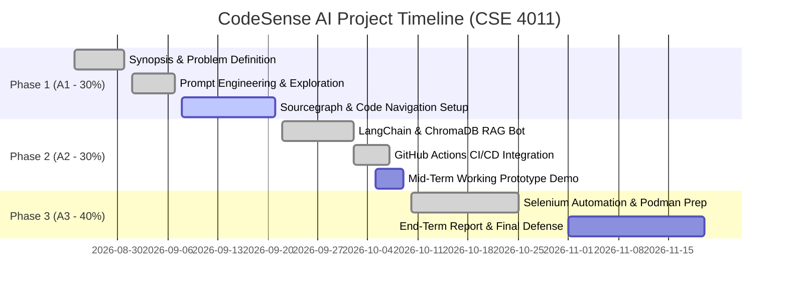

# CodeSense AI — Project Charter & Academic Synopsis
**Course:** CSE 4011: Intelligent Developer Tools and AI DevOps Workflows  
**Institution:** School of Engineering and Technology, BML Munjal University  
**Academic Year:** 2026–27 | 7th Semester | Batch 2023–27  
**Team Members:** Jhalak Kapila (Lead), Khushi Hooda, Aastha Thakur  
**Evaluation Component:** A1 — Project Phase Evaluation 1 (Weightage: 30%)  

---

## 1. Problem Definition (C1)
Modern software engineering organizations face compounding technical debt and high developer cognitive load when navigating complex, distributed microservice codebases. Traditional static code search tools rely solely on lexical or regex matching, failing to capture semantic architectural intent, inter-service contracts, or runtime failure modes. Furthermore, conventional CI/CD pipelines only execute pre-written, static test suites, leaving regressions and untested boundary conditions undetected until production deployment.

**CodeSense AI** bridges this gap by deploying an intelligent, end-to-end AI-augmented software development and DevOps automation pipeline. It integrates **AST-aware semantic retrieval (RAG)** with **automated CI/CD quality gates**, allowing developers to query codebases naturally, identify architectural risks, and auto-generate regression test suites during pull requests.

---

## 2. Project Objectives & Expected Outcomes (C2)
* **O1 (Semantic Repository Intelligence):** Ingest and index entire source code repositories using language-specific Abstract Syntax Tree (AST) splitters and dense vector embeddings stored in a persistent ChromaDB vector space.
* **O2 (High-Speed Code Retrieval & Reasoning):** Deploy an interactive developer interface powered by Groq LPU inference, providing sub-second semantic code Q&A with transparent reasoning (`<think>` traces) and precise source code line citations.
* **O3 (Automated CI/CD Quality Gate):** Implement a GitHub Actions workflow that executes automated code style audits (`flake8`), regression test suites (`pytest`), and LLM-driven PR diff security reviews.
* **O4 (End-to-End Test Automation):** Verify developer UI flows using headless **Selenium WebDriver** browser automation.
* **O5 (OCI-Compliant Containerization):** Package the solution into multi-stage production images compatible with both **Docker** and daemonless **Podman Compose** runtimes.

---

## 3. Methodology & Technical Architecture (C3)

### System Architecture Pipeline
```text
[ Developer Entry ]               [ Source Layer ]
  ├─ Streamlit Web UI (Port 8501)   ├─ sample_repo (Microservice)
  └─ Selenium E2E Automation        └─ Dynamic GitHub Cloner

              │                                   │
              ▼                                   ▼
   [ Natural Language Query ]             [ AST Code Parsing ]
              │                     RecursiveCharacterTextSplitter(Python)
              ▼                                   │
    [ HuggingFace Vectors ]                       ▼
   all-MiniLM-L6-v2 (384-dim)             [ Dense Vector DB ]
              │                                ChromaDB
              └───────────────┬───────────────────┘
                              ▼
                     [ Top-K RAG Search ]
                     Cosine Similarity (k=3)
                              ▼
                    [ Groq LPU Inference ]
                    Qwen / Llama-3 Models
                              ▼
              [ Verified Answer + Source Citations ]
                              │
                    [ CI/CD Quality Gate ]
              GitHub Actions • Flake8 • Pytest
```

### Logically Separated Services & System Topology (CSE 4011 Framework)
In accordance with the course's architectural guidelines, CodeSense AI operates as a set of decoupled, coordinated services:

1. **Application Service (`app.py`):** Handles developer interactions, responsive dark-themed console rendering, prompt suggestions, and collapsible reasoning trees (`<think>`).
2. **Data & Knowledge Service:** Manages multi-mode source code ingestion across built-in microservices (`sample_repo`), dynamic GitHub URL shallow clones, uploaded `.zip` archives, and local directories.
3. **Embedding Service (`rag_engine.py`):** Converts AST-chunked source code into 384-dimensional dense vectors using open-source, local CPU-based `sentence-transformers/all-MiniLM-L6-v2`.
4. **RAG & Retrieval Service (`rag_engine.py`):** Indexes vectors into an in-process persistent ChromaDB store; performs cosine similarity searches to retrieve the top-k semantically relevant code chunks with mathematical relevance scores.
5. **LLM Inference Service:** Manages high-speed communication with cloud-based Groq LPUs (`qwen/qwen3.8-27b`, `llama3-70b`) for sub-second generation, with full compatibility for local Ollama models.
6. **Git & DevOps Service (`scripts/ai_pr_reviewer.py` & `.github/workflows/ai-check.yml`):** Functions as a dedicated boundary for Git operations; inspects PR `git diff`, executes Flake8 linting, runs automated Pytest test suites, and generates PR security audits.
7. **Orchestration Layer (`rag_engine.py`):** Coordinates LangChain prompt templates, context formatting, and streaming output parsers to ensure requests move seamlessly across the pipeline.

### 🛡️ Guardrails & Scope Control Architecture
- **Input Guardrail & Scope Control:** Accurately detects out-of-domain requests (e.g. unintegrated payment systems like Stripe or external queries like weather) and enforces zero-hallucination refusals grounded strictly in repository context.
- **Output Guardrail & Grounding:** Ensures every claim made by the LLM is substantiated by active code chunks, surfaced directly through collapsible **Source Citations** with file paths and similarity scores.
- **Rate Limit & Token Guardrail:** Enforces dynamic token ceilings (600–800 tokens) with automatic fallback and retry logic to prevent API throttling.

---

## 4. Feasibility & Resource Planning (C4)

| Resource Layer | Technology Selected | Justification & Feasibility |
| :--- | :--- | :--- |
| **Frontend UI** | Streamlit (Python) | Lightweight, reactive, fast turnaround, seamless Python data pipeline binding. |
| **Embeddings** | `sentence-transformers/all-MiniLM-L6-v2` | Open-source, runs locally on CPU with zero latency overhead and zero API cost. |
| **Vector Store** | ChromaDB (In-Process) | Embedded serverless vector DB, persistent storage without cloud dependencies. |
| **LLM Inference** | Groq LPU Cloud (Qwen / Llama 3) | Free tier available, 500+ tokens/sec throughput, ideal for real-time developer demos. |
| **CI/CD** | GitHub Actions | Native Git integration, zero infrastructure overhead for automated pipelines. |
| **UI Automation** | Selenium WebDriver | Industry-standard E2E browser automation for interface regression testing. |
| **Containers** | Docker & Podman Compose | OCI-compliant multi-stage build, portable between Windows host and Ubuntu Linux VM. |

---

## 5. Project Timeline & Milestones



---

## 6. Team Responsibility Matrix

| Team Member | Project Role | Contribution % | Module Responsibilities & Key Deliverables |
| :--- | :--- | :---: | :--- |
| **Jhalak Kapila** *(Lead)* | Lead AI & DevOps Architect | **50%** | Core LangChain RAG pipeline, AST code chunking, ChromaDB vector store, Groq LPU acceleration, GitHub Actions CI/CD Quality Gate, Sweep.dev PR Reviewer (`rag_engine.py`, `scripts/ai_pr_reviewer.py`, `.github/workflows/ai-check.yml`, `cli.py`, `Dockerfile`) |
| **Khushi Hooda** | Testing, Automation & QA Lead | **32%** | CodiumAI Behavior-driven test generation, Backend Pytest microservice unit suites, Selenium WebDriver headless Chrome E2E browser automation, Flake8 linting gate (`tests/test_sample_repo.py`, `tests/test_ui_selenium.py`) |
| **Aastha Thakur** | UI/UX & Tool Setup Assistant | **18%** | Streamlit DevOps Web Console frontend layout & dark-theme styling, multi-mode repository ingestion loaders, local Sourcegraph OSS container verification, documentation formatting (`app.py`, `scripts/run_sourcegraph.bat`, `PROJECT_CHARTER.md`, `DEMO_GUIDE.md`) |
