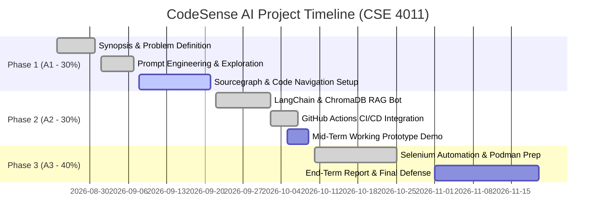

# CodeSense AI — Project Charter & Academic Synopsis
**Course:** CSE 4011: Intelligent Developer Tools and AI DevOps Workflows  
**Institution:** School of Engineering and Technology, BML Munjal University  
**Academic Year:** 2026–27 | 7th Semester | Batch 2023–27  
**Evaluation Component:** A1 — Project Phase Evaluation 1 (Weightage: 30%)  

---

## 1. Problem Definition (C1)
Modern software engineering organizations face compounding technical debt and high developer cognitive load when navigating complex, distributed microservice codebases. Traditional static code search tools rely solely on lexical or regex matching, failing to capture semantic architectural intent, inter-service contracts, or runtime failure modes. Furthermore, conventional CI/CD pipelines only execute pre-written, static test suites, leaving regressions and untested boundary conditions undetected until production deployment.

**CodeSense AI** bridges this gap by deploying an intelligent, end-to-end AI-augmented software development and DevOps automation pipeline. It integrates **AST-aware semantic retrieval (RAG)** with **automated CI/CD quality gates**, allowing developers to query codebases naturally, identify architectural risks, and auto-generate regression test suites during pull requests.

---

## 2. Project Objectives & Expected Outcomes (C2)
* **O1 (Semantic Repository Intelligence):** Ingest and index entire source code repositories using language-specific Abstract Syntax Tree (AST) splitters and dense vector embeddings stored in a persistent ChromaDB vector space.
* **O2 (High-Speed Code Retrieval & Reasoning):** Deploy an interactive developer interface powered by Groq LPU inference, providing sub-second semantic code Q&A with transparent reasoning (`<think>` traces) and precise source code line citations.
* **O3 (Automated CI/CD Quality Gate):** Implement a GitHub Actions workflow that executes automated code style audits (`flake8`), regression test suites (`pytest`), and LLM-driven PR diff security reviews.
* **O4 (End-to-End Test Automation):** Verify developer UI flows using headless **Selenium WebDriver** browser automation.
* **O5 (OCI-Compliant Containerization):** Package the solution into multi-stage production images compatible with both **Docker** and daemonless **Podman Compose** runtimes.

---

## 3. Methodology & Technical Architecture (C3)

### System Architecture Pipeline
```text
[ Developer Entry ]               [ Source Layer ]
  ├─ Streamlit Web UI (Port 8501)   ├─ sample_repo (Microservice)
  └─ Selenium E2E Automation        └─ Dynamic GitHub Cloner

              │                                   │
              ▼                                   ▼
   [ Natural Language Query ]             [ AST Code Parsing ]
              │                     RecursiveCharacterTextSplitter(Python)
              ▼                                   │
    [ HuggingFace Vectors ]                       ▼
   all-MiniLM-L6-v2 (384-dim)             [ Dense Vector DB ]
              │                                ChromaDB
              └───────────────┬───────────────────┘
                              ▼
                     [ Top-K RAG Search ]
                     Cosine Similarity (k=3)
                              ▼
                    [ Groq LPU Inference ]
                    Qwen / Llama-3 Models
                              ▼
              [ Verified Answer + Source Citations ]
                              │
                    [ CI/CD Quality Gate ]
              GitHub Actions • Flake8 • Pytest
```

### Architectural Subsystems
1. **Developer Experience & UI Layer:** Interactive Streamlit dashboard with real-time model switching, query presets, and collapsible reasoning trees.
2. **Indexing & Embedding Pipeline:** Source files are split at logical function and class boundaries via LangChain's code-aware splitters and converted into 384-dimensional dense vectors using `sentence-transformers/all-MiniLM-L6-v2`.
3. **Inference & Orchestration Layer:** Top-ranked context chunks are augmented with custom system prompts and processed via Groq LPUs for sub-second responses.
4. **DevOps Automation Pipeline:** GitHub Actions runs automated linting, test suites, and dynamic AI PR diff audits via `scripts/ai_pr_reviewer.py`.

---

## 4. Feasibility & Resource Planning (C4)

| Resource Layer | Technology Selected | Justification & Feasibility |
| :--- | :--- | :--- |
| **Frontend UI** | Streamlit (Python) | Lightweight, reactive, fast turnaround, seamless Python data pipeline binding. |
| **Embeddings** | `sentence-transformers/all-MiniLM-L6-v2` | Open-source, runs locally on CPU with zero latency overhead and zero API cost. |
| **Vector Store** | ChromaDB (In-Process) | Embedded serverless vector DB, persistent storage without cloud dependencies. |
| **LLM Inference** | Groq LPU Cloud (Qwen / Llama 3) | Free tier available, 500+ tokens/sec throughput, ideal for real-time developer demos. |
| **CI/CD** | GitHub Actions | Native Git integration, zero infrastructure overhead for automated pipelines. |
| **UI Automation** | Selenium WebDriver | Industry-standard E2E browser automation for interface regression testing. |
| **Containers** | Docker & Podman Compose | OCI-compliant multi-stage build, portable between Windows host and Ubuntu Linux VM. |

---

## 5. Project Timeline & Milestones



---

## 6. Team Responsibility Matrix

| Team Member / Role | Module Responsibilities | Deliverables |
| :--- | :--- | :--- |
| **Lead Developer** | Core RAG Architecture, LangChain Orchestration, ChromaDB Vector Pipeline | `rag_engine.py`, Vector storage, AST chunking logic |
| **DevOps & CI/CD Specialist** | GitHub Actions Workflow, Flake8 Linters, Pytest Suites, AI PR Diff Reviewer | `.github/workflows/ai-check.yml`, `scripts/ai_pr_reviewer.py` |
| **Frontend & QA Engineer** | Streamlit Web Console, Dynamic GitHub Cloner, Selenium E2E Automation Test | `app.py`, `tests/test_ui_selenium.py` |
| **Containerization Lead** | Dockerfile multi-stage optimization, Docker Compose, Podman compatibility | `Dockerfile`, `docker-compose.yml`, VM migration scripts |
